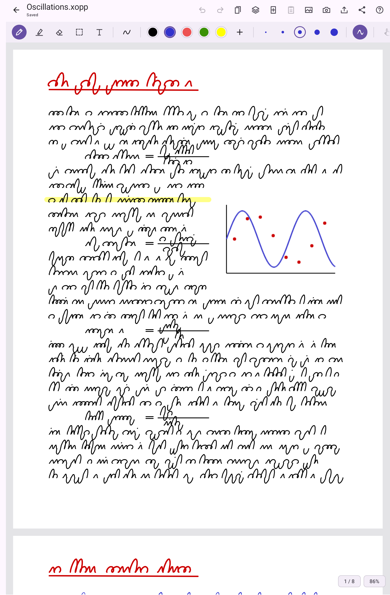
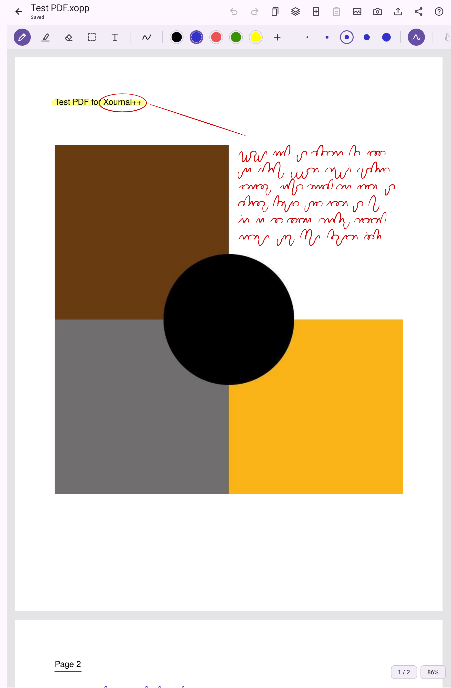
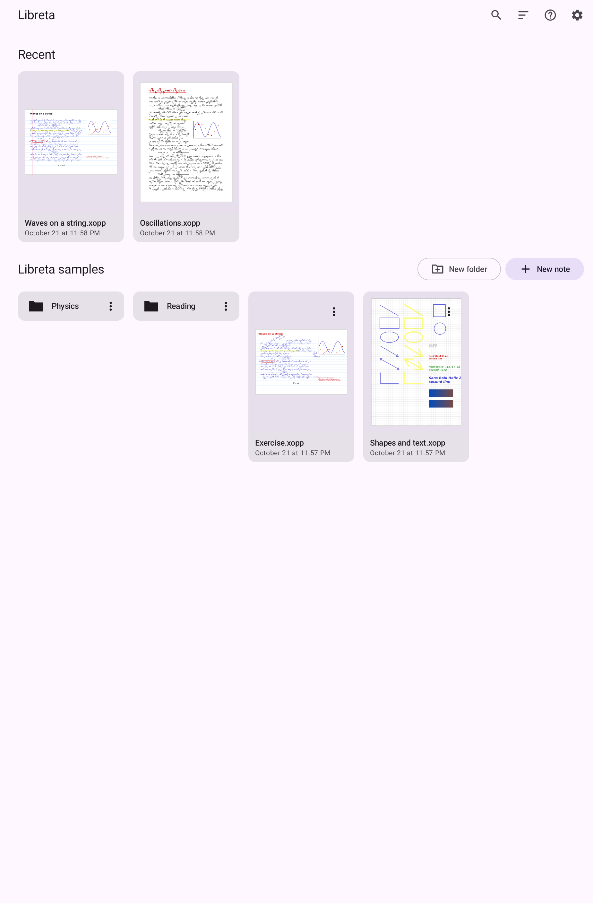
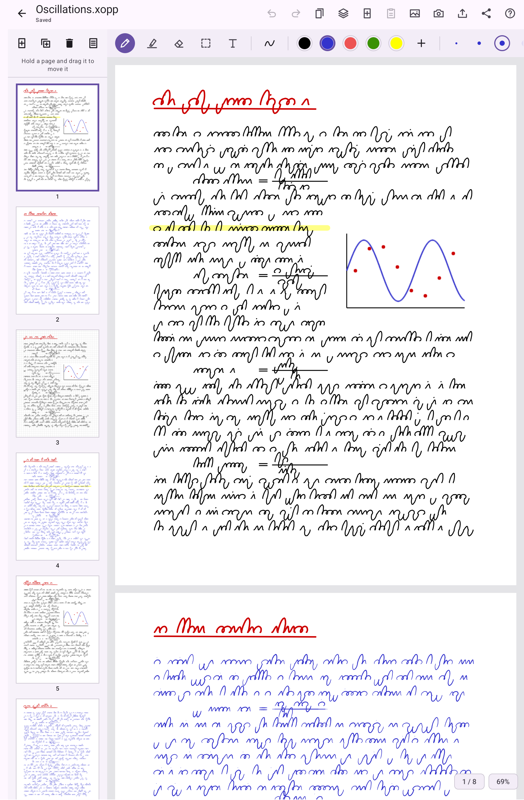
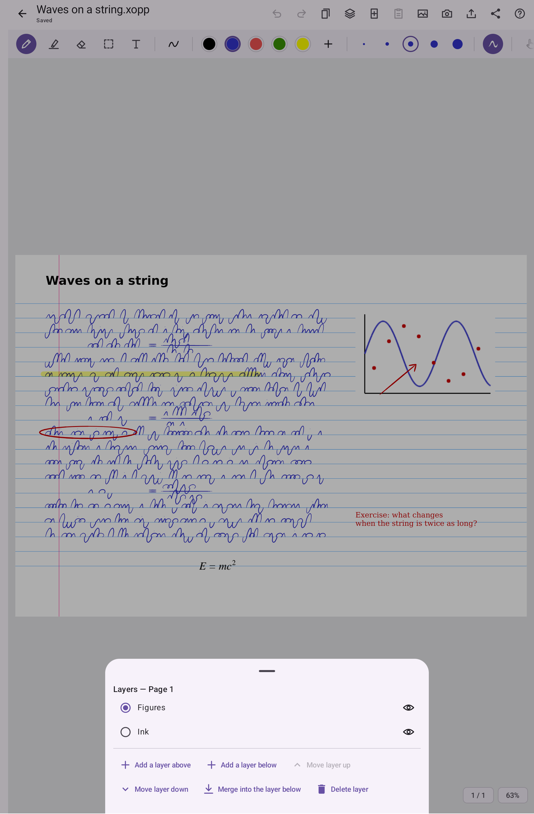

# Libreta

Libreta is a notebook for writing by hand with a stylus on Android tablets. It reads and
writes the file format of [Xournal++](https://xournalpp.github.io/) (`.xopp`), so the same
notes open on the computer with Xournal++ and on the tablet with Libreta.

<p align="center">
  
  
  
</p>
<p align="center">
  
  
</p>

- Pen with pressure, highlighter, eraser, shapes, text, pictures, selection, pages and layers
- Notes on PDFs, kept next to the PDF as Xournal++ keeps them; export to PDF
- A library of the folders you choose, on the device or in any storage app (such as Nextcloud)
- No ads, no tracking, no internet access

## Android Install

Libreta needs Android 10 or later.

1. On the tablet, download `libreta-X.Y.Z.apk` from the
   [latest release](https://github.com/asafpm/Libreta/releases/latest).
2. Open the downloaded file. The first time, Android asks you to allow installing apps
   from your browser or file manager.

To update, install the APK of a newer release the same way; your notes and settings stay.

## Building

```sh
./gradlew :android:app:assembleRelease   # android/app/build/outputs/apk/release/
./gradlew check ktlintCheck detekt       # tests and lint
```

It needs JDK 17 or later and the Android SDK (`local.properties` or `ANDROID_HOME`).

The signed APK of a release is built from a fresh clone of its tag with
`scripts/release-apk.sh vX.Y.Z`.

## Licence

Libreta is free software under the GNU General Public License, version 2 or (at your
option) any later version: see [LICENSE](LICENSE). Parts of it are derived from Xournal++,
and it includes libraries and fonts under their own licences: see [NOTICE.md](NOTICE.md)
and [licenses/](licenses/). The app shows them under Settings, About.
